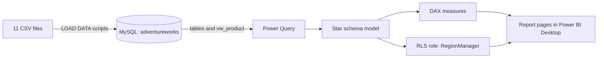

# Enterprise Business Intelligence Suite for a Multi-Region Company

An end-to-end Power BI solution for a bicycle and accessories retailer: MySQL source database, star-schema model, 19 DAX measures, executive and detail report pages, and row-level security by region.

Built by Sasirekha K as an internship project. Data covers 1 January 2020 to 30 June 2022 (about 56,000 order lines).

## Headline results

| Measure | Value |
|---|---|
| Revenue / Profit / Margin | $24.9M / $10.5M / 41.97% |
| Units sold / Return rate | 84,174 / 2.17% |
| Revenue growth | +45.6% in 2021; H1 2022 is +211.1% on H1 2021 (same months) |
| Discount as share of list revenue | 5.0% (2020), 14.3% (2021), 32.8% (H1 2022) |
| Net margin after discount | 37.5% (2020) falling to 14.2% (H1 2022) |

The main finding: list-price margin holds near 42%, but rising discounts cut net margin by more than half.

## Architecture

## Data model

Facts: Sales (56,046 rows) and Returns (1,809). Dimensions: Calendar, Product (flattened with subcategory and category), Territory, Customer (18,148). Seven one-to-many relationships, single direction. Discounts are looked up in DAX by year and category.

## Report pages

- **Executive Summary:** six KPI cards, year and region slicers, monthly revenue with 3-month rolling average, list vs net revenue by year, revenue by region.
- **Region Detail:** drill-through from a region, with revenue, profit, margin, units, monthly trend and revenue by subcategory.

## Row-level security

Role `RegionManager` filters the Territory table using a user-to-region mapping table. Users are placeholders (for example `canada.mgr@adventureworks.test`) because the source files contain no manager data. Tested in Power BI Desktop with View as.

## Repository contents

| Path | Contents |
|---|---|
| `sql/` | Schema, load, validation and refresh-test scripts |
| `powerbi/` | The Power BI report (.pbix) |
| `docs/` | Full project documentation: data quality, model, measures, insights, test log |
| `data/` | Instructions only; raw files are excluded because they hold personal data |

## Setup

1. Install MySQL Server 8.0 and MySQL Workbench.
2. Run `SET GLOBAL local_infile = 1;` and add `OPT_LOCAL_INFILE=1` on its own line in the connection's Advanced tab.
3. Run `sql/01_create_schema.sql`, then `sql/02_load_data.sql` (edit the folder path first), then `sql/03_validation.sql`. Expect 84,174 units, $24,914,587 revenue, $10,457,715 profit.
4. Install MySQL Connector/NET 8.0.x and restart Power BI Desktop.
5. Open `powerbi/AdventureWorks.pbix`, go to Transform data > Manage Parameters, set `MySQLServer` and `MySQLDatabase`, enter your MySQL login, then Close & Apply.
6. Check the Executive Summary: margin 41.97%, return rate 2.17%.

## Scope and limitations

Publishing to Power BI Service was descoped because no work account was available, so the report refreshes manually in Desktop. Northeast, Central and Southeast have almost no sales in the sample data. Discount rates are read as a percentage off list price (an assumption, see the documentation).
